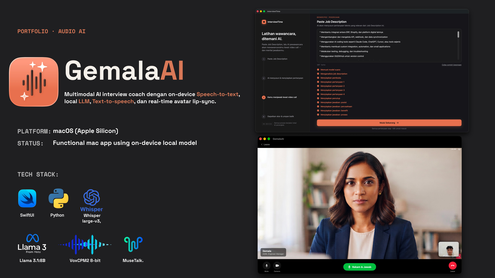

# InterviewTime (GemalaAI)

InterviewTime is an interactive AI mock interview application for macOS. It combines native SwiftUI with local and cloud AI inference to provide real-time voice conversations and lip-synced avatar animations.



## Architecture

- **Frontend**: macOS native client built with SwiftUI and AVFoundation.
- **Audio & Speech (STT/TTS)**:
  - Speech-to-Text: OpenAI Whisper integration.
  - Text-to-Speech: MLX-accelerated VoxCPM2 for Apple Silicon and CUDA/PyTorch for cloud deployments (port 8808).
- **Video & Lip-Sync**: MuseTalk real-time facial animation accelerated via CoreML (macOS) and PyTorch (NVIDIA GPU) (port 8810).
- **Intelligence**: LLM reasoning engine supporting local models (Ollama) and cloud APIs.

## Prerequisites

- macOS Sonoma (14.0) or later with Apple Silicon (M1/M2/M3/M4 recommended)
- Xcode 15.0+
- Python 3.10+
- Conda or virtualenv
- (Optional) NVIDIA GPU with CUDA 12.1+ for cloud deployment

## Installation

### 1. Repository Setup

Clone the repository and run the setup script:

```bash
git clone <repository-url>
cd AI-ML-Audio
chmod +x setup.sh start.sh
./setup.sh
```

The setup script creates the necessary Python environments, downloads required model checkpoints, and exports CoreML artifacts for local acceleration.

### 2. Environment Configuration

Copy the example environment configuration in the backend folder:

```bash
cp backend/.env.example backend/.env
```

Set your model paths, API keys, and service hosts as needed.

## Running the Application

### 1. Start the Backend Services

Launch both the TTS and Lip-Sync microservices:

```bash
./start.sh
```

Default endpoints:
- MLX TTS Service: `http://localhost:8808`
- MuseTalk Lip-Sync Service: `http://localhost:8810`

### 2. Launch the macOS App

1. Open `InterviewTime.xcodeproj` in Xcode.
2. Select your development team in Signing & Capabilities.
3. Build and run the project targeting `My Mac (Designed for macOS)`.

## Deployment Options

### Local (Apple Silicon)
Optimized for Apple Neural Engine (ANE) and Metal using MLX and CoreML. Zero cloud dependency required when paired with local Ollama instances.

### Cloud GPU (Docker)
For Linux systems with NVIDIA GPUs:

```bash
cd backend
docker-compose up -d --build
```

### Serverless (RunPod / Modal)
- **Modal**: Deploy with `modal deploy backend/tts/modal_app.py`
- **RunPod**: Build using `backend/tts/runpod_handler.py` as entrypoint for serverless endpoints.

## Project Structure

```
├── InterviewTime/          # Native macOS SwiftUI application
├── InterviewTime.xcodeproj # Xcode project configuration
├── backend/                # Unified backend services
│   ├── core/               # Configuration and audio utilities
│   ├── tts/                # MLX and CUDA TTS servers
│   └── lipsync/            # MuseTalk pipeline and CoreML exporters
├── models/                 # Model checkpoints (downloaded)
├── setup.sh                # Environment initialization script
└── start.sh                # Local service launcher
```

## License

This project is licensed under the terms specified in the LICENSE file.
